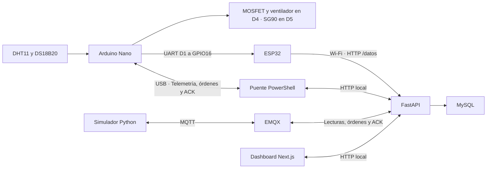

# Actualización del artículo de Smart Cooling IoT

Corte operativo del 25 de noviembre de 2026, entre las 13:32:58 y las 13:33:00, hora de Lima (UTC−05:00). Este documento reúne los cambios del prototipo, la evidencia histórica revisada en el borrador del artículo y los resultados operativos disponibles para actualizar la metodología, los resultados y la discusión.

## 1. Arquitectura y alcance actual

Smart Cooling IoT se despliega localmente con Docker Compose. El dashboard usa Next.js. FastAPI procesa la telemetría y ejecuta el modelo predictivo. MySQL conserva el historial y los eventos de control simulado. EMQX transporta la telemetría y las órdenes del simulador Python. phpMyAdmin permite consultar la base de datos. La interfaz y la API se publican en `localhost:3000` y `localhost:8000`, respectivamente.

| Modo | Estaciones visibles | Control de la ventilación |
| --- | --- | --- |
| Hardware real | PC 1 con DHT11 y PC 2 con DS18B20 | El Arduino Nano usa las lecturas locales. La interfaz web puede enviarle órdenes temporales por USB. |
| Híbrido | PC 1 y PC 2 físicas. PC 3 a PC 5 simuladas. | El Nano gobierna el montaje físico. FastAPI envía órdenes por MQTT al simulador para las estaciones virtuales. |
| Simulación | Cinco estaciones virtuales | FastAPI puede controlar el simulador en modo automático predictivo o manual. |

La interfaz identifica el origen de cada lectura en las tarjetas, alertas y gráficas. El historial se filtra por zona y origen. En modo híbrido, una zona física sin señal se indica como tal y el simulador mantiene sus propias estaciones.

## 2. Montaje físico y cableado

| Elemento | Conexión utilizada |
| --- | --- |
| DHT11 | Datos a D2 del Nano. Alimentación y tierra desde los rieles del Nano. Proporciona temperatura y humedad para PC 1. |
| DS18B20 | Datos a D3 del Nano. Resistencia pull-up de 10 kΩ entre D3 y el riel de 5 V. Proporciona temperatura para PC 2. |
| Ventilador de 50 × 50 mm y módulo MOSFET | D4 a la entrada de disparo del MOSFET. El ventilador se alimenta mediante una fuente de 5 V conectada al módulo. La fuente y el Nano comparten tierra. |
| Servomotor SG90 | Señal en D5 y alimentación en los rieles de 5 V y GND del Nano. La paleta del servo desvía el flujo de un mismo ventilador hacia las dos zonas. |
| ESP32 | GPIO16 recibe la señal desde TX del Nano (D1). El divisor usa 1 kΩ entre D1 y GPIO16 y 2 kΩ entre GPIO16 y GND. El ESP32 tiene su propio USB y comparte la tierra de señal. |

El enlace UART del montaje instalado va del Nano al ESP32. El gateway publica por Wi-Fi las temperaturas, la humedad, el estado del ventilador y la edad de la trama. El control desde el dashboard usa el USB del Nano, identificado como COM5 en la PC de prueba, y el puente local de PowerShell. Las órdenes físicas llevan un identificador y se confirman con un ACK del Nano. El ángulo mostrado por USB representa la posición ordenada por el firmware. La posición mecánica y las revoluciones del ventilador se comprueban por observación o con instrumentación adicional.

## 3. Funcionalidades implementadas

### Adquisición y supervisión

- El Nano toma lecturas con un período configurado de 2,5 s. El DS18B20 convierte en segundo plano y se lee después de una espera de 800 ms, de forma que el programa puede seguir atendiendo el servo y el puerto serie.
- FastAPI consulta el ESP32 cada 2 s en la configuración por defecto. La edad de la trama permite distinguir lecturas vigentes, antiguas y ausentes. La recepción de una lectura válida de un sensor puede mantenerse aunque el otro falle.
- El dashboard recuperó las vistas de Monitoreo, Indicadores, Estadísticas y Control. Incluye el historial por estación, la comparación entre temperatura observada y pronóstico, las alertas y la actividad de control simulado. Estadísticas también presenta los tres CSV históricos con su procedencia.

### Control en el prototipo

- Cada zona demanda aire al alcanzar 30 °C y libera la demanda a 29 °C. Entre ambos valores conserva su estado anterior. El ventilador se enciende cuando alguna zona demanda aire y se apaga en automático cuando las dos demandas quedan inactivas.
- El firmware asigna 45° al DS18B20, 135° al DHT11 y 90° al reposo. Al iniciar el enfriamiento de las dos zonas prioriza la mayor temperatura disponible. Cuando ambas mantienen la demanda, alterna cada 20 s. Una lectura inválida activa la ventilación de protección.
- Los controles físicos permiten encender el ventilador, elegir un ángulo de la paleta o volver a automático. La orden manual dura 30 s. El botón **Pausar ventilador y servo** apaga la salida D4 y corta los pulsos de D5 durante ese intervalo con lecturas válidas. El SG90 sigue alimentado por el riel de 5 V. La pausa termina por vencimiento o ante un fallo de sensor.
- El dial físico separa el ángulo reportado por el Nano del ángulo elegido. El deslizador ofrece pasos de 5° y el dial ofrece accesos a 45°, 90° y 135°. La orientación visual se corrigió para mostrar **135° a la izquierda, 90° al centro y 45° a la derecha**. El botón de movimiento aplica el valor numérico seleccionado.

### Control en el simulador

- El simulador publica lecturas por MQTT aproximadamente cada 5 s. Los temas de telemetría usan `lab/piloto/+/temp`. Las órdenes viajan por `lab/piloto/accion` y las confirmaciones por `lab/piloto/ack`.
- FastAPI ordena ventilación si la temperatura observada o la proyectada de una zona alcanza 35 °C. Orienta el servo virtual hacia la zona prioritaria. Sin una alerta crítica activa, la histéresis permite apagar el ventilador cuando todas las zonas simuladas con señal bajan de 32 °C. Si el objetivo deja de estar disponible, el controlador puede apagar la ventilación o elegir otro objetivo según la demanda.
- Los escenarios disponibles son normal, sobrecalentamiento, carga extrema, demostración y fallo de sensor. En híbrido, el control MQTT se limita a zonas virtuales. El ACK registra el identificador de orden, la zona, el ángulo, el estado del ventilador y la latencia cuando está disponible.

## 4. Modelo predictivo y evaluación

Se utiliza regresión lineal de Scikit-learn sobre la temperatura en función del tiempo. Cada zona y origen usa una ventana móvil propia de hasta 40 muestras. La predicción se genera desde tres observaciones válidas y proyecta 600 s. El algoritmo amortigua la pendiente cuando la ventana temporal es corta y limita el cambio proyectado a un intervalo de −4,5 a +5,5 °C. El pronóstico final se acota entre 20 y 48 °C. En el montaje físico el pronóstico sirve para supervisión y alertas. En simulación también interviene en la decisión de activar el ventilador.

La evaluación operativa empareja el pronóstico emitido en el instante T con la lectura almacenada más próxima a T + 600 s, con tolerancia de ±45 s. Se exige coincidencia de zona y origen y se evita reutilizar la misma observación. La consulta reporta hasta 120 pares por origen. Las métricas son MAE, RMSE y R². Los pares corresponden al historial disponible y pueden variar en cada consulta. Para una comparación publicable conviene identificar la versión del modelo, congelar los pares de evaluación y desglosar el resultado por sensor o escenario.

## 5. Resultados históricos revisados para el artículo

| Fuente de evidencia | Resultados |
| --- | --- |
| [`datos_hardware_real.csv`](datos_hardware_real.csv) | 125 lecturas archivadas como físicas. El DHT11 registró 65 lecturas entre 30,0 y 35,5 °C. El DS18B20 registró 60 lecturas de 33,7 °C. Se identificó una transición de ventilador apagado a encendido en PC 1. |
| [`eventos_enfriamiento_antes_despues.csv`](eventos_enfriamiento_antes_despues.csv) | 60 eventos con confirmación simulada. Hubo 57 órdenes autónomas y 3 manuales. La mediana de latencia registrada fue de 88,72 ms. La temperatura proyectada en este archivo es un valor del modelo. |
| [`analisis_reduccion_termica_antes_despues.csv`](analisis_reduccion_termica_antes_despues.csv) | 25 pares de temperaturas con una caída media declarada de 2,90 °C. Sus 25 temperaturas iniciales coinciden por zona y valor con eventos simulados. Los valores finales carecen de hora, sensor e identificador común que permitan vincularlos con el prototipo. |

En la transición histórica de PC 1, el DHT11 pasó de 34,0 °C en la última lectura con ventilador apagado a 35,5 °C en la primera lectura con ventilador encendido. La siguiente lectura fue de 34,2 °C tras 173,0 min. Respecto de la primera lectura con encendido, el cambio fue de −1,3 °C. Respecto de la última lectura con apagado, fue de +0,2 °C. El intervalo y la falta de una condición de comparación dejan pendiente estimar el efecto aislado del ventilador.

## 6. Resultados operativos al corte

La API reportó activos MySQL, MQTT, el ESP32 y el puente USB. El dashboard estaba en **Hardware Real** y mostró las dos estaciones físicas con datos vigentes. La ventilación física estaba encendida y el Nano reportaba modo automático. Los pronósticos de la siguiente tabla se registraron como estimaciones a 10 minutos.

| Estación | Temperatura observada | Pronóstico a +10 min | Humedad |
| --- | ---: | ---: | ---: |
| PC 1 · DHT11 | 30,4 °C | 28,44 °C | 60,0 % |
| PC 2 · DS18B20 | 30,2 °C | 29,21 °C | — |

### Precisión predictiva sobre el historial disponible

| Origen | Pares | MAE | RMSE | R² |
| --- | ---: | ---: | ---: | ---: |
| Sensores físicos | 120 | 0,644 °C | 0,904 °C | −2,9290 |
| Simulación MQTT | 120 | 4,362 °C | 5,075 °C | −1,8424 |

En los dos conjuntos seleccionados, el R² negativo indica que el pronóstico obtuvo un error cuadrático mayor que el de usar la media de las observaciones de su conjunto como referencia. Son resultados descriptivos de la ventana consultada. Las fuentes corresponden a condiciones, rangos térmicos y secuencias diferentes.

### Indicadores del simulador

- MySQL tenía 4 794 filas de telemetría con origen virtual. El intervalo medio calculado para las lecturas recientes fue de 5,01 s.
- El historial de control simulado tenía 153 eventos. La API reportó 100 % de ACK en ese conjunto y una latencia media de 75,93 ms. Esto caracteriza la confirmación de órdenes en el simulador. Para estimar la tasa de entrega de telemetría se requieren conteos en el emisor y en el receptor.
- El ventilador figuró encendido en el 85,5 % de las lecturas virtuales de la última hora. Esta proporción describe registros. Medir el tiempo efectivo de funcionamiento y el consumo en Wh requiere observaciones específicas.

| Prueba exploratoria en datos simulados | Muestra | Resultado al corte |
| --- | ---: | ---: |
| t pareada entre disparo y primera lectura de la zona entre 120 y 135 s después de una orden confirmada | 30 pares | p = 0,007620 |
| t de una muestra para latencia de ACK frente a 200 ms | 40 latencias | p < 0,000001 |
| ANOVA de una vía entre zonas simuladas | 150 lecturas | p < 0,000001 |
| Shapiro–Wilk sobre residuos del pronóstico | 120 residuos | p = 0,0017 |

En las pruebas t de latencia y ANOVA, la API devolvió 0,000000 al redondear a seis decimales. La dependencia entre lecturas consecutivas y la repetición de órdenes durante una misma sesión limitan la interpretación inferencial de estos resultados.

## 7. Verificación funcional del desarrollo

| Prueba | Evidencia observada |
| --- | --- |
| Integración de hardware y modos | Pasaron las cinco pruebas automatizadas de adquisición, antigüedad de la trama, fallo del DS18B20, modos de operación y pérdida de conexión con el ESP32. Se ejecutaron con un servidor ESP32 simulado e independiente del montaje. |
| Enfriamiento autónomo virtual | En carga extrema el simulador confirmó encendido y orientación de PC 4 a 135°. Al volver a condiciones normales, quedó registrado el apagado automático con ACK en esa misma zona. |
| Fallo de sensor en híbrido | PC 3 quedó sin señal durante el escenario de fallo. El ESP32 mantuvo disponibles las lecturas de ambos sensores físicos. |
| Actuación desde el dashboard | El Nano confirmó una orden por USB y reportó el objetivo de 90°. El operador observó el movimiento del servo y el giro del ventilador. |
| Pausa física | Con los sensores por encima de 30 °C, el Nano confirmó el apagado del ventilador y la interrupción de pulsos del servo. El ESP32 también reportó el ventilador apagado. El operador confirmó que el ventilador se detuvo y la paleta quedó quieta. La observación de telemetría registró el retorno a automático tras 34,1 s de tiempo de prueba, que incluye la entrega de la orden y la actualización del estado. El temporizador del firmware está configurado a 30 s. |
| Orientación del dial | El navegador confirmó el orden visual 135°, 90° y 45°, la correspondencia de la aguja con la telemetría y el incremento de 5° en el ajuste. La prueba visual se realizó sobre la selección previa a enviar una orden. |

Estas pruebas verifican adquisición, visualización, control y confirmación. La magnitud de enfriamiento en cada zona y el eventual ahorro energético siguen siendo resultados experimentales pendientes.

## 8. Cambios para la siguiente versión del artículo

1. **Resumen y alcance.** Presentar el aporte como un prototipo de monitoreo, pronóstico y ventilación autónoma de dos zonas físicas, con simulación MQTT para ampliar los escenarios de prueba.
2. **Método.** Incluir el cableado, la diferencia entre el control local y el remoto, el horizonte del modelo, las reglas de emparejamiento y las condiciones de cada prueba. Identificar el origen y la fecha de captura en cada tabla o figura.
3. **Resultados.** Informar primero la verificación del montaje y después las métricas de predicción y los resultados simulados. Los pares históricos de origen incompleto pueden figurar como revisión documental con su limitación de trazabilidad.
4. **Discusión y próxima prueba.** Para cuantificar el enfriamiento físico, comparar ciclos con carga térmica, ambiente y montaje equivalentes. Definir una duración de seguimiento y contrastar la evolución con y sin ventilación bajo las mismas condiciones. Registrar un identificador por ciclo, sensor, temperatura inicial, momento de activación, ángulo, estado, lecturas posteriores y consumo medido en Wh cuando corresponda.

## Fuentes de verificación

- Borrador `Articulo IoT - INGENIUS.docx` y tres archivos CSV identificados en la sección de resultados históricos.
- Montaje y comunicación descritos en los diagramas de cableado proporcionados durante la integración y en el [firmware del Nano](firmware/arduino_nano/arduino_nano.ino), el [gateway ESP32](firmware/esp32_gateway/esp32_gateway.ino) y el [puente USB](puente_nano.ps1).
- Implementación de la [predicción](backend/app/ml_model.py), el [emparejamiento de observaciones](backend/app/database.py), el [control MQTT](backend/app/mqtt_service.py) y las [pruebas estadísticas](backend/app/statistics_service.py).
- Corte local consultado por los endpoints `/api/health`, `/api/control/estado`, `/api/hardware/estado`, `/api/metricas?origen=real`, `/api/metricas?origen=virtual`, `/api/indicadores`, `/api/estadisticas/pruebas` y `/api/estadisticas/evidencia`.
