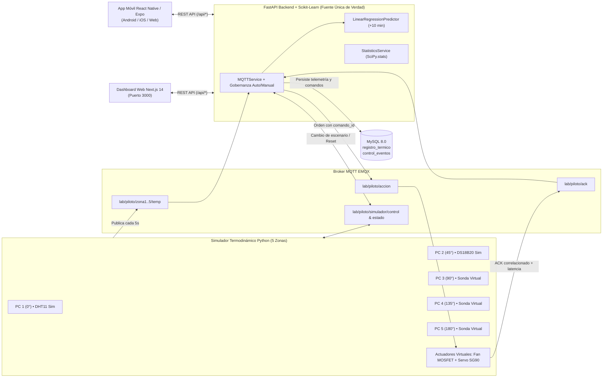

# 02. ARQUITECTURA EN MODO SIMULACIÓN UNIFICADO

**Proyecto:** Sistema de Enfriamiento Autónomo Inteligente para Equipos Electrónicos (IoT)  
**Versión:** 2.0.0

---

## 1. Diagrama de Flujo Unificado (Sin Circuito Físico)

---

## 2. Principios Arquitectónicos Clave

1. **FastAPI como Fuente Única de Verdad (`Single Source of Truth`):**
   - Tanto el **Dashboard Web (`frontend/`)** como la **Aplicación Móvil (`mobile/`)** consumen los mismos endpoints REST de FastAPI (`http://<host>:8000/api/*`).
   - Esto garantiza que ambas pantallas muestren exactamente las mismas temperaturas, predicciones a +10 minutos, ángulo del servomotor, estado del ventilador, modo de control (`AUTOMÁTICO` / `MANUAL`), escenario activo e indicadores estadísticos.

2. **Trazabilidad y Honestidad Metodológica (`MODO SIMULACIÓN`):**
   - Cada lectura térmica incluye `origen = "virtual"` y `modo_simulacion = True`.
   - Cada comando emitido genera un identificador único `comando_id` (`cmd_<timestamp>_<uuid>`) con estado inicial `PENDIENTE`.
   - Cuando el simulador procesa la orden de orientación del servomotor y encendido del ventilador, devuelve un paquete MQTT en `lab/piloto/ack` con el mismo `comando_id`, actualizando el registro en MySQL a `EJECUTADO_SIMULACION` y registrando la latencia real medida en milisegundos.

3. **Preparación para Hardware Físico Futuro:**
   - La variable de entorno `SIMULATION_MODE` en `simulador/simulador.py` permite conmutar de `"5_zonas"` (fase actual sin circuito) a `"3_zonas"` cuando se conecten el Arduino Nano y el ESP32 reales para `zona1` y `zona2`, sin modificar la base de datos ni las interfaces.

